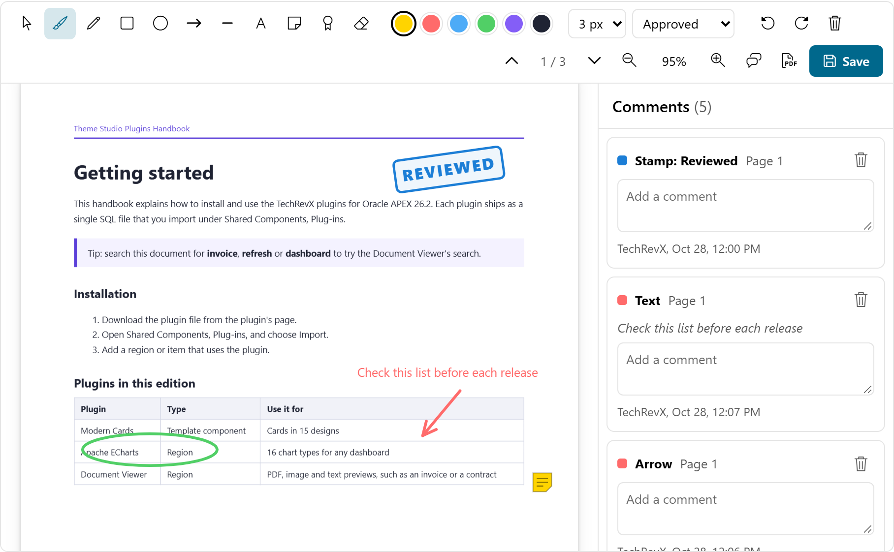

# PDF Annotation for Oracle APEX

Mark up PDFs in the page with highlights, drawings, shapes, text, sticky notes and stamps, then save the annotations or export an annotated PDF.



**[Live demo](https://oracleapex.com/ords/r/aamirkhanz/plugins/pdf-annotation)**: sign in as `demo` with the password `Demo`.

| | |
|---|---|
| **Type** | Region plug-in |
| **Internal name** | `COM.TECHREVX.PDF_ANNOTATION` |
| **Version** | 1.0 |
| **Live demo** | [oracleapex.com/ords/r/aamirkhanz/plugins/pdf-annotation](https://oracleapex.com/ords/r/aamirkhanz/plugins/pdf-annotation) (user `demo`, password `Demo`) |
| **Requires** | Oracle APEX 26.2 or later |
| **License** | MIT |

## What it does

PDF Annotation lets users mark up a PDF inside your application: review contracts, approve drawings, correct reports. Annotations are saved as JSON with your own PL/SQL and can be exported into a new PDF.

- **Tools**: highlight text (or an area on scanned pages), pen, rectangle, ellipse, arrow, line, text box, sticky note, stamps such as Approved and Rejected, eraser.
- **Editing**: select to move or delete, change color and line width, undo and redo (Ctrl+Z, Ctrl+Y), double-click a text box to edit it.
- **Comments panel**: every annotation with its author, time, page and comment; click to jump to it.
- **Saving**: a Save button, automatic saving, or JavaScript only. Leaving with unsaved changes asks for confirmation.
- **Export PDF**: downloads the document with the annotations drawn in, for sharing outside the application.
- **Review mode**: shows annotations and comments read only.

## At a glance

- **Source**: any region source; the first row is the document. Map ID, File Name and the PDF (BLOB) or a URL, plus the column with saved annotations.
- **Tools**: highlight (selected text, or an area on scanned pages), pen, rectangle, ellipse, arrow, line, text box, sticky note with comment, stamps (Approved, Rejected and your own), eraser; select to move, recolor or delete; undo and redo; colors and line widths.
- **Comments panel**: every annotation with author, time and comment; click to jump to it.
- **Saving**: Save button, automatic saving, or JavaScript only. The Save Code receives :ANNOTATIONS (JSON, CLOB) and :ID.
- **Export PDF**: downloads the PDF with the annotations drawn in (pdf-lib, included). Review mode shows annotations read only.
- **JavaScript**: apex.region( "id" ).getAnnotations(), setAnnotations( json ), save(), exportPdf().
- **Events**: PDF Annotation - Annotations Changed and Annotations Saved.
- PDF.js (Apache License 2.0) and pdf-lib (MIT License) are included.

## Installation

1. Download `plugin/region_type_plugin_com_techrevx_pdf_annotation.sql` from the [latest release](https://github.com/aamirkhanz/apex-plugin-pdf-annotation/releases/latest) (or from this repository).
2. In App Builder, open your application and go to **Shared Components > Plug-ins**.
3. Choose **Import**, select the file and finish the wizard.
4. Create a region of type **PDF Annotation [Plug-in]**, select the document row, map the columns and enter the Save Code.

Everything the plug-in needs is inside the SQL file, including PDF.js and pdf-lib; it loads nothing from other sites.

## Example

```sql
select doc_id, file_name, file_blob, annotations
  from documents
 where doc_id = :P20_DOC_ID
```

```sql
-- Save Code
update documents
   set annotations  = :ANNOTATIONS,
       annotated_by = :APP_USER,
       annotated_on = sysdate
 where doc_id = :ID;
```

:ID is checked against the region's own document before the Save Code runs, and Review mode never saves.

## Attributes

### Data

| Attribute | Type | Default | Description |
|---|---|---|---|
| **ID Column** (required) | Region source column |  | Key of the document, available as :ID in the Save Code. |
| **File Name Column** (required) | Region source column |  | Shown in the toolbar and used for the exported file name. |
| **PDF Column** | Region source column |  | The PDF file (BLOB). The region shows the first row of its source. |
| **URL Column** | Region source column |  | Optional address of the PDF when the row has no PDF content, for example #APP_FILES#contract.pdf. |
| **Annotations Column** | Region source column |  | The saved annotations (JSON written by this plug-in), shown when the document opens. Leave empty to start without annotations. |
| **Height** (required) | Integer | `720` |  |

### Annotation

| Attribute | Type | Default | Description |
|---|---|---|---|
| **Tools** | Checkboxes | `highlight:pen:rectangle:ellipse:arrow:line:text:note:stamp:eraser` | Drawing tools in the toolbar. Highlight marks selected text, or a dragged area on scanned pages. Note adds a sticky note with a comment. Select (always present) moves, recolors and deletes annotations. Values: `highlight` Highlight, `pen` Pen, `rectangle` Rectangle, `ellipse` Ellipse, `arrow` Arrow, `line` Line, `text` Text Box, `note` Sticky Note, `stamp` Stamp, `eraser` Eraser. |
| **Stamps** | Text | `Approved, Rejected, Reviewed, Draft, Confidential` | Comma-separated stamp texts offered by the Stamp tool. Approved is green, Rejected red, others blue unless the text contains a color hint. Shown when Tools has a value. |
| **Colors** (required) | Text | `#ffd400, #ff6b6b, #4dabf7, #51cf66, #845ef7, #1f2333` | Comma-separated colors offered in the toolbar. The first one is selected when the viewer opens. |
| **Author** | Text | `&APP_USER.` | Name stored with every new annotation and comment, and shown in the comments panel. |
| **Mode** (required) | Select list | `edit` | Review shows the annotations and comments without the drawing tools, for readers who should not change them. Values: `edit` Annotate, `review` Review (Read Only). |

### Saving

| Attribute | Type | Default | Description |
|---|---|---|---|
| **Save** (required) | Select list | `button` | Save Button: a Save button in the toolbar; leaving the page with unsaved changes asks for confirmation. Automatically: saves two seconds after each change. Not Saved: keep the annotations in the browser and read them with JavaScript (apex.region( "id" ).getAnnotations()). Values: `button` Save Button, `auto` Automatically, `none` Not Saved. |
| **Save Code** | PL/SQL code |  | PL/SQL that stores the annotations. :ANNOTATIONS holds the JSON (CLOB) and :ID the document key; page items are bound by name. Shown when Save is `button` or `auto`. |
| **Features** | Checkboxes | `comments:export:pages:zoom` | Comments Panel: lists every annotation with its author, time and comment. Export PDF: downloads the PDF with the annotations drawn into it. Page Navigation and Zoom: toolbar controls. Values: `comments` Comments Panel, `export` Export PDF, `pages` Page Navigation, `zoom` Zoom. |

## Events

Available in Dynamic Actions, and as jQuery events on the region or item:

- **PDF Annotation - Annotations Changed** (`tx-pdfannot-change`)
- **PDF Annotation - Annotations Saved** (`tx-pdfannot-save`)

## Annotation JSON

:ANNOTATIONS in the Save Code and the Annotations Column use this format. Positions are in PDF points on the page (72 per inch) from the top-left corner, so they do not depend on the zoom.

```text
{
  "version": 1,
  "document": "42",
  "annotations": [
    { "id": "a1", "type": "highlight", "page": 1, "color": "#ffd400",
      "rects": [ [ 72, 140, 210, 16 ] ], "text": "selected words",
      "author": "ANNA", "created": "2026-10-29T08:15:00Z", "comment": "Check the figure" },
    { "id": "a2", "type": "arrow", "page": 2, "x1": 100, "y1": 300, "x2": 160, "y2": 260, "width": 3, "color": "#ff6b6b" },
    { "id": "a3", "type": "note",  "page": 2, "x": 520, "y": 90, "comment": "Signature missing" },
    { "id": "a4", "type": "stamp", "page": 3, "x": 380, "y": 60, "text": "Approved" }
  ]
}
```

Other types: `pen` (points), `rectangle`, `ellipse` and `line` (x1, y1, x2, y2), `text` (x, y, text, size). Query it with SQL, for example the open comments of a document:

```sql
select j.page, j.author, j.comment_text
  from documents d,
       json_table( d.annotations, '$.annotations[*]'
         columns ( page number path '$.page', author varchar2(255) path '$.author',
                   comment_text varchar2(4000) path '$.comment' ) ) j
 where d.doc_id = :P20_DOC_ID and j.comment_text is not null
```

## Events and JavaScript

```text
PDF Annotation - Annotations Changed   after every change; this.data = { count }
PDF Annotation - Annotations Saved     after a successful save; this.data = { count }
```

```javascript
apex.region( "review" ).getAnnotations();        // the JSON object
apex.region( "review" ).setAnnotations( json );  // replace them
apex.region( "review" ).save();                  // run the Save Code now
apex.region( "review" ).exportPdf();             // download the annotated PDF
```

With Save set to Not Saved, read the annotations in a Dynamic Action and store them yourself, for example in a page item before submit.

## Included libraries

| Library | Version | License |
|---|---|---|
| [PDF.js](https://mozilla.github.io/pdf.js/) | 6.4.299 | Apache-2.0 |
| [pdf-lib](https://pdf-lib.js.org) | 1.17.1 | MIT |

See [THIRD-PARTY-NOTICES.md](THIRD-PARTY-NOTICES.md).

## Repository contents

- `plugin/region_type_plugin_com_techrevx_pdf_annotation.sql`: the plug-in, ready to import
- `src/`: the plug-in's own source (PL/SQL in `plugin.pls`, JavaScript and CSS), for reading and reviewing; the SQL file already contains it
- `apexplugin.json`: the plug-in's details for [apex.world](https://apex.world)

## License

MIT, see [LICENSE](LICENSE). The included libraries keep their own licenses.

## More plug-ins

Documentation, updates and more plug-ins for Oracle APEX: [www.techrevx.com](https://www.techrevx.com)
